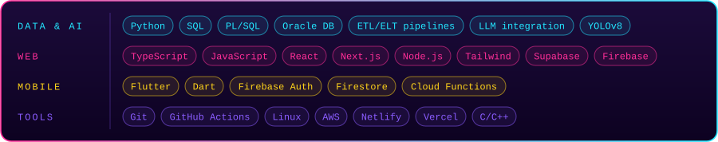

  

  I build LLM-powered automation, data pipelines and business-specific customizations by day, currently in fintech, 
  and ship full products on the side: web, mobile and the backend behind them.

  <a href="mailto:mehdy922@gmail.com"><b>Email</b></a> &nbsp;·&nbsp;
  <a href="https://linkedin.com/in/muhammadmehdy"><b>LinkedIn</b></a> &nbsp;·&nbsp;
  Lahore, Pakistan (UTC+5)

- **Data & AI engineer at Techlogix.** Building AI tools that cut manual workflows from hours to minutes, plus ETL/ELT pipelines and business-specific customizations in Oracle PL/SQL.
- **Shipping side products end to end.** Most recently [Neural Lab](https://mehdy922.github.io/neural-lab/), a browser app that lets a classroom train and break its own neural networks, and [RazeTech](https://razetech-pk.netlify.app), a full e-commerce storefront and admin panel.
- **Product-minded.** Former product management intern at PakWheels, where I led a redesign that lifted task completion by 35%. I care about what gets built, not only how.

  
  

  
  

  
  

  Cards marked LIVE open the running app. Source for <a href="https://github.com/Mehdy922/neural-lab">Neural Lab</a> is public; the rest lives in private repos.

  

  

Best way to reach me is email: **[mehdy922@gmail.com](mailto:mehdy922@gmail.com)**. I'm also on [LinkedIn](https://linkedin.com/in/muhammadmehdy).

  

